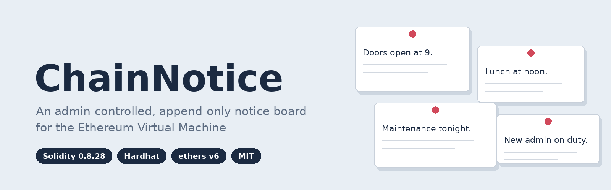
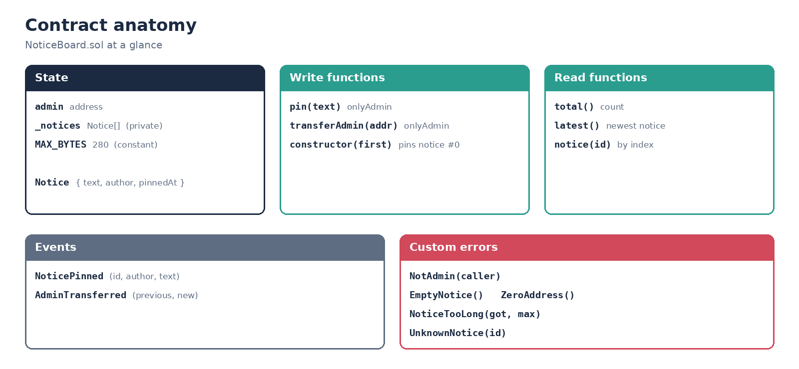
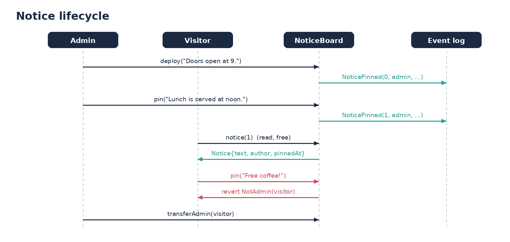
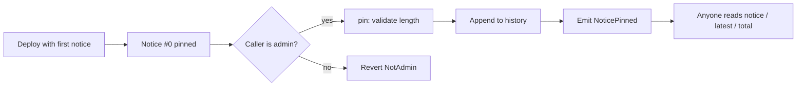
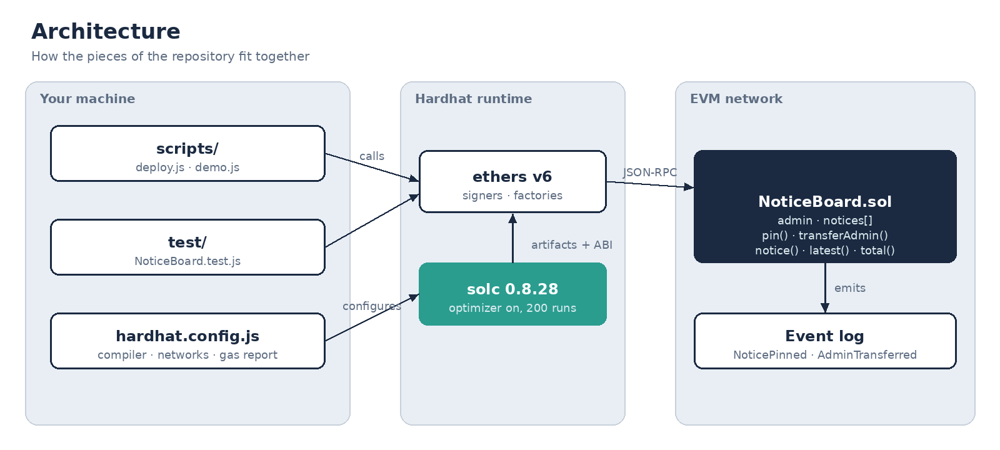
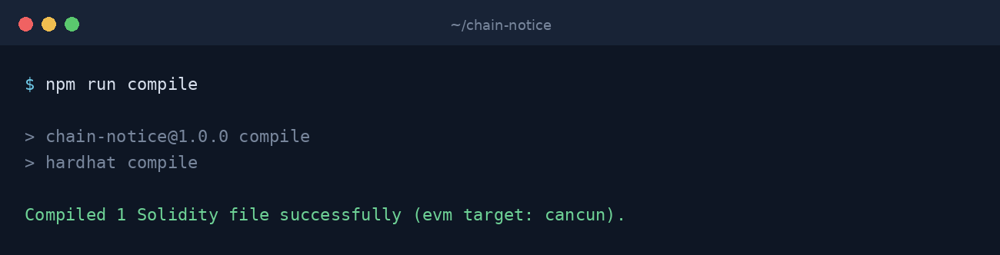
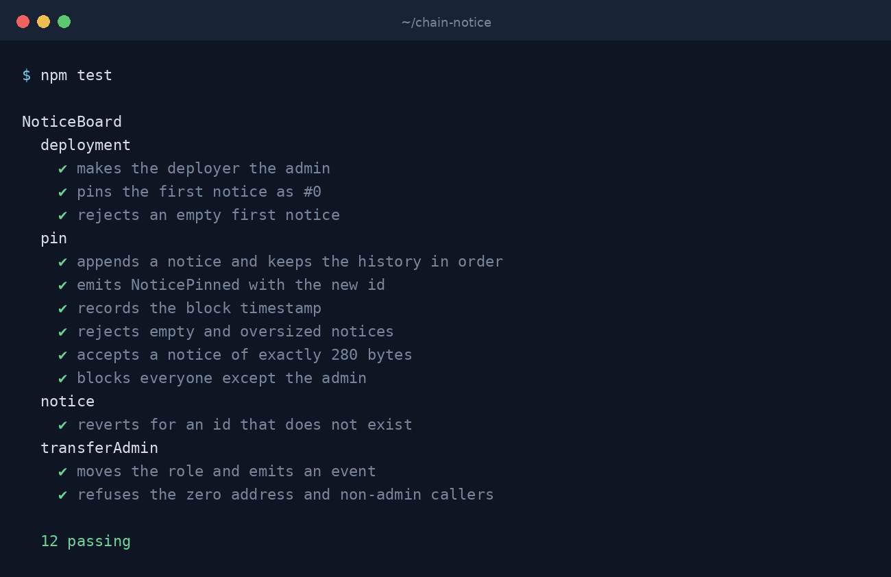
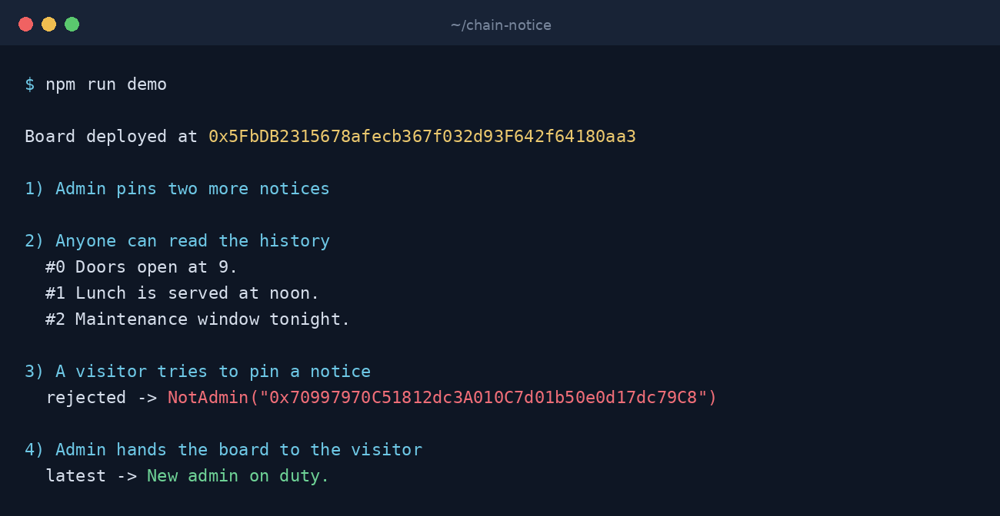
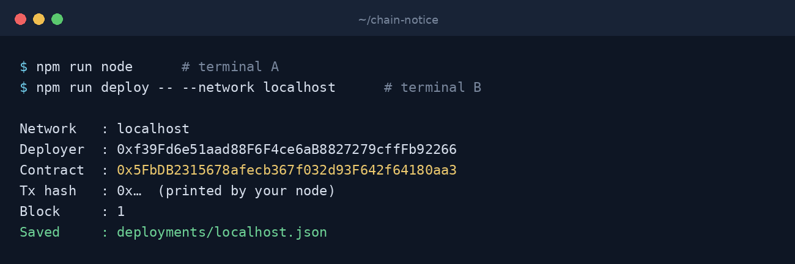

<p align="center">
  
</p>

# ChainNotice

ChainNotice is a small, readable Solidity project meant for learning. it covers structs, dynamic arrays, events, custom errors, modifiers and basic access control, and it ships with a complete Hardhat test suite and runnable scripts

---

## What you will learn

| Concept | Where to see it |
| --- | --- |
| Structs and dynamic storage arrays | `Notice` and `_notices` in `NoticeBoard.sol` |
| Constructor-time initialisation | The constructor pins notice #0 |
| Access control with a modifier | `onlyAdmin` guarding `pin` and `transferAdmin` |
| Events for off-chain consumers | `NoticePinned`, `AdminTransferred` |
| Gas-friendly custom errors | `NotAdmin`, `NoticeTooLong`, and friends |
| Testing with fixtures and matchers | `test/NoticeBoard.test.js` |
| Scripted deployment and records | `scripts/deploy.js` writes `deployments/<network>.json` |

## How it works

<p align="center">
  
</p>

The admin (the deployer, initially) can pin notices of up to 280 bytes. Each notice stores its text, its author and the block timestamp, and is appended to an array, so the full history stays readable at any time. Reading is free for everyone. The admin role can be handed to another account.

<p align="center">
  
</p>

The same flow as a Mermaid diagram (renders natively on GitHub):



## Project layout

```text
chain-notice/
├── contracts/
│   └── NoticeBoard.sol        # the smart contract
├── scripts/
│   ├── deploy.js              # deploys and records the address
│   └── demo.js                # full lifecycle walkthrough in one process
├── test/
│   └── NoticeBoard.test.js    # 12 tests (Mocha + Chai + Hardhat matchers)
├── docs/images/               # banner, diagrams, terminal screenshots
├── hardhat.config.js          # compiler, optimizer, networks, gas reporter
└── package.json
```

<p align="center">
  
</p>

## Quick start

**Requirements:** Node.js 18 or newer and npm.

```bash
npm install        # install dependencies
npm run compile    # compile the contract
npm test           # run the test suite
npm run demo       # watch the whole lifecycle play out
```

## Walkthrough with screenshots

### 1. Compile



### 2. Test



### 3. Run the demo



### 4. Deploy to a local node



Set `FIRST_NOTICE` to choose the opening text:

```bash
FIRST_NOTICE="Welcome, team!" npm run deploy -- --network localhost
```

## Contract reference

### State

| Name | Type | Description |
| --- | --- | --- |
| `admin` | `address` | Account allowed to pin notices and transfer the role |
| `MAX_BYTES` | `uint256` (constant) | Maximum notice size, 280 bytes |

### Functions

| Function | Access | Description |
| --- | --- | --- |
| `constructor(string firstNotice)` | deploy only | Sets the deployer as admin and pins notice #0 |
| `pin(string text) → uint256 id` | admin | Appends a notice and returns its index |
| `transferAdmin(address newAdmin)` | admin | Hands over the admin role |
| `total() → uint256` | anyone | Number of notices pinned so far |
| `latest() → Notice` | anyone | The newest notice |
| `notice(uint256 id) → Notice` | anyone | Notice by index |

### Events

| Event | Arguments |
| --- | --- |
| `NoticePinned` | `uint256 indexed id, address indexed author, string text` |
| `AdminTransferred` | `address indexed previousAdmin, address indexed newAdmin` |

### Errors

| Error | Raised when |
| --- | --- |
| `NotAdmin(caller)` | A non-admin calls an admin function |
| `EmptyNotice()` | The text is empty |
| `NoticeTooLong(got, max)` | The text exceeds 280 bytes |
| `UnknownNotice(id)` | The requested index does not exist |
| `ZeroAddress()` | `transferAdmin` is called with the zero address |

## Scripts and commands

| Command | What it does |
| --- | --- |
| `npm run compile` | Compile contracts |
| `npm test` | Run the test suite |
| `REPORT_GAS=true npm test` | Run tests with a gas report |
| `npm run coverage` | Generate a coverage report |
| `npm run node` | Start a local JSON-RPC node on port 8545 |
| `npm run deploy -- --network localhost` | Deploy to the local node |
| `npm run demo` | Run the end-to-end demo on the in-process network |
| `npm run clean` | Remove build artifacts and cache |

## Design decisions

- **Append-only history.** Notices cannot be edited or deleted, so the board doubles as an audit trail
- **Custom errors over revert strings.** They are cheaper to deploy and carry structured data that tests and front-ends can decode
- **Calldata for external input.** `pin` takes `string calldata` to avoid an unnecessary memory copy
- **Length measured in bytes.** `bytes(text).length` is what costs gas, so the limit is expressed in bytes, not characters
- **Single admin.** Kept deliberately simple. A multisig or role-based scheme is listed in the roadmap
